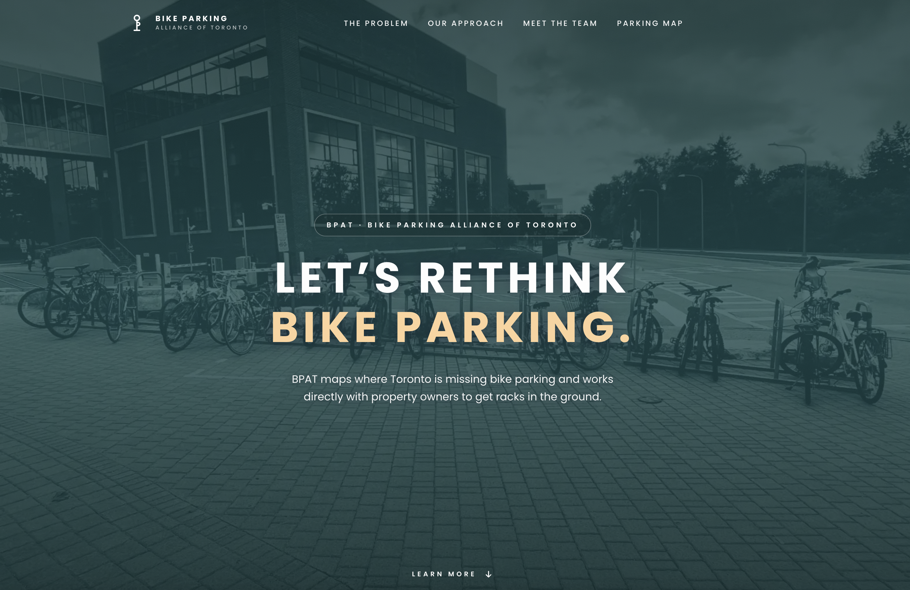

# BPAT Website

Public website for BPAT, the Bike Parking Alliance of Toronto. BPAT maps where Toronto is missing bike parking, makes the case to property owners, and helps get racks in the ground.



## Live Site

- Production: https://bpat.ca/
- Main pages:
  - Home: https://bpat.ca/
  - Gap Map: https://bpat.ca/map
  - Team: https://bpat.ca/team

The domain is referenced in SEO metadata, canonical URLs, structured data, `robots.txt`, `sitemap.xml`, and `llms.txt`.

Deployment platform details are not stored in this repo. The repo only contains GitHub Actions CI for linting and building. If this site is deployed through Vercel, Netlify, Cloudflare Pages, GitHub Pages, or another host, document the provider, project name, production branch, and any required environment variables here once confirmed.

## Tech Stack

- React 19
- TypeScript
- Vite
- Tailwind CSS 4
- React Router
- Framer Motion
- React Helmet Async
- Leaflet and React Leaflet for the map

## Requirements

- Node.js 22, matching `.github/workflows/ci.yml`
- npm

## Getting Started

Install dependencies:

```sh
npm ci
```

Start the local dev server:

```sh
npm run dev
```

Build for production:

```sh
npm run build
```

Preview the production build locally:

```sh
npm run preview
```

Run lint checks:

```sh
npm run lint
```

## Available Scripts

- `npm run dev`: starts the Vite development server.
- `npm run build`: runs TypeScript project checks and creates a production build in `dist/`.
- `npm run lint`: runs ESLint across the repo.
- `npm run preview`: serves the built `dist/` output locally.

## Project Structure

```text
.
|-- index.html              # App shell, global SEO metadata, structured data
|-- public/                 # Static assets, manifest, robots.txt, sitemap, llms.txt
|-- src/
|   |-- App.tsx             # Routes and scroll behavior
|   |-- main.tsx            # React entry point and Helmet provider
|   |-- index.css           # Tailwind theme, shared classes, global styles
|   |-- assets/             # SVG artwork used by components
|   |-- components/         # Shared page sections and UI components
|   |   `-- experiment/     # Sections used only by the experimental homepage
|   |-- data/               # Team members, social links, static spot/map data
|   `-- pages/              # Home, map, team, and experimental routes
`-- .github/workflows/ci.yml
```

## Routes

- `/`: landing page with hero, ticker, bike parking request banner, problem statement, approach, owner CTA, and FAQ.
- `/map`: interactive Gap Map powered by BikeSpace API submissions.
- `/team`: team page with member cards and headshot fallbacks.
- `/experiment`: experimental homepage redesign, see [Experimental Homepage](#experimental-homepage).

`MapPage`, `TeamPage`, and `ExperimentPage` are lazy-loaded in `src/App.tsx` so the homepage does not load heavier secondary route code on first paint.

## Content And Data

- Homepage sections live in `src/components/` and are assembled in `src/pages/HomePage.tsx`.
- Team members are defined in `src/data/team.ts`, shared by the team page and the experimental homepage.
- Social accounts and their icons are defined in `src/data/socials.ts`.
- Team headshots live in `public/headshots/` and are matched by lowercased, hyphenated member names, such as `richard-li.jpg`.
- Static map spot examples live in `src/data/spots.ts`, though the live Gap Map currently uses BikeSpace submissions.
- The hero photo ships as `public/bike-bg.webp` (1600px) and `public/bike-bg-960.webp` (960px, for phones), with `public/bike-bg.jpeg` as the fallback and social preview image. If you replace the photo, regenerate both WebP sizes and keep the `imagesrcset` preload in `index.html` in sync.
- `public/video-poster.webp` is the poster for the YouTube short on the experimental homepage.
- Public SEO and crawler files live in `public/robots.txt`, `public/sitemap.xml`, and `public/llms.txt`.

## Experimental Homepage

`/experiment` is a redesign of the homepage kept on its own route so it can be compared with `/` side by side. It is marked `noindex` and is intentionally left out of `sitemap.xml` and `llms.txt`.

- Page: `src/pages/ExperimentPage.tsx`; sections: `src/components/experiment/`.
- Styling: sentence case throughout (no uppercase or wide letter-spacing), a warm `paper` background colour defined in `src/index.css`, and `.x-*` utility classes at the bottom of that file.
- Motion (Framer Motion, all respecting reduced-motion settings):
  - Hero photo fades into the page.
  - BikeSpace section: three phone mockups that settle into place as you scroll, built in HTML/SVG rather than screenshots.
  - Team section: pins while every member rides across the screen on a bike, with their headshot as the rider's head.
  - Request-form card near the bottom rises in once when it first comes into view.
  - Lists fade in with a short stagger.
- On phones the page snaps onto the YouTube short when scrolled near it. The short shows a local poster and only loads YouTube's player when pressed.
- Nothing on `/` depends on it. To promote it, point the `/` route at `ExperimentPage`, update its in-page links from `/experiment#…` to `/#…`, and remove the `noindex` tag.

## BikeSpace API

The Gap Map reads and writes reports through the BikeSpace development API:

```ts
https://api-dev.bikespace.ca/api/v2
```

Used endpoints:

- `GET /submissions?limit=100`
- `POST /submissions`

There are no local environment variables for this API right now; the base URL is hardcoded in `src/pages/MapPage.tsx`.

## SEO Notes

Global metadata is in `index.html`, including:

- Canonical production URL
- Open Graph tags
- Twitter card tags
- Organization structured data
- Website structured data
- Breadcrumb structured data
- FAQ structured data

Route-level metadata is managed with `react-helmet-async` in the page components.

When adding or removing public routes, update:

- `src/App.tsx`
- `public/sitemap.xml`
- `public/llms.txt`
- `index.html` structured data if the route should appear in breadcrumbs or SEO metadata

## CI

GitHub Actions runs on pull requests and pushes to `main` or `master`:

1. Install dependencies with `npm ci`
2. Run `npm run lint`
3. Run `npm run build`

Workflow file: `.github/workflows/ci.yml`

## Deployment Checklist

Before deploying, run:

```sh
npm run lint
npm run build
```

After deploying, check:

- https://bpat.ca/
- https://bpat.ca/map
- https://bpat.ca/team
- https://bpat.ca/sitemap.xml
- https://bpat.ca/robots.txt
- https://bpat.ca/llms.txt

Also confirm that social preview images resolve, especially:

```text
https://bpat.ca/bike-bg.jpeg
```

## Contact And Social Links

- Website: https://bpat.ca
- Email: bpat.toronto@gmail.com
- Instagram: https://www.instagram.com/bpat.toronto/
- X/Twitter: https://x.com/BPAT_Toronto
- Bluesky: https://bsky.app/profile/bpat-toronto.bsky.social

## Notes For Future Maintainers

- The production domain is `bpat.ca`; keep canonical URLs consistent.
- `TestBadge` is hidden on `bpat.ca` and appears on non-production hosts.
- The app uses `BrowserRouter`, so the deployment host must support SPA fallback routing to `index.html` for `/map`, `/team`, and `/experiment`. The site is built on Netlify, which gets this from `public/_redirects` (`/*  /index.html  200`); without it, direct visits and refreshes on those routes return 404.
- Google Fonts is loaded without blocking first paint (`rel="preload"` swapped to a stylesheet on load, with a `<noscript>` fallback) in `index.html`.
- Keep generated build output in `dist/`; source changes belong in `src/`, `public/`, and project config files.
